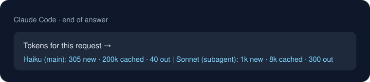

# Economy Tokens para Claude Code

**Gaste menos tokens no Claude Code.** O Economy Tokens avisa quando a conversa fica longa (e cara) e mostra, no fim de cada resposta, quantos tokens cada modelo usou.

Criado por [FabioLima77](https://github.com/FabioLima77). English: see [README.md](README.md).



## Por que

O Claude relê a conversa inteira a cada resposta. Um chat com 300 mil tokens custa muito mais por mensagem do que um chat novo. O plugin mostra esse custo e avisa na hora certa para você começar de novo.

## O que faz

| Parte | Quando | O que faz |
| --- | --- | --- |
| Linha do modelo | Início de cada resposta | Abre cada resposta com uma linha que diz qual modelo está respondendo, por exemplo `[Haiku 5.5 · principal]`, para você saber sempre qual modelo está gastando. |
| Aviso de conversa longa | Antes de cada pedido | Avisa e pede ao Claude para sugerir uma conversa nova com um resumo, quando o chat passa do seu limite. |
| Rodapé de tokens | Fim de cada resposta | Mostra os tokens do modelo principal, dos subagentes e do conselheiro. |
| Skill `economy-tokens` | Quando você pergunta como economizar | Explica os hábitos que mantêm o custo baixo. |

Tudo roda no seu computador. Nada é enviado para fora.

## Instalação

Depois que o repositório estiver público, rode os dois comandos no terminal, um de cada vez:

```bash
claude plugin marketplace add FabioLima77/economy-tokens-claude-code
```

```bash
claude plugin install economy-tokens@economy-tokens-marketplace
```

Para instalar a partir de uma pasta no seu computador:

```bash
claude plugin marketplace add "C:\caminho\para\economy-tokens-claude-code"
```

Depois, inicie uma conversa nova para os ganchos carregarem.

## Configuração

| Variável | Padrão | Significado |
| --- | --- | --- |
| `ECONOMY_TOKENS_LIMIT` | `300000` | Tokens lidos por resposta antes do aviso de conversa longa. |
Coloque no bloco `env` do arquivo `~/.claude/settings.json`, por exemplo `"ECONOMY_TOKENS_LIMIT": "170000"`.

Para escolher o modelo do chat principal, dos subagentes e do conselheiro, veja [docs/model-setup.md](docs/model-setup.md).

## Como desligar

```bash
claude plugin disable economy-tokens@economy-tokens-marketplace
```

Para ligar de novo, use `enable` no lugar de `disable`. Para remover, use `uninstall`.

## Limites

- Testado com Claude Code 2.1 no Windows 11. Usa só Node.js, que o Claude Code já traz. Mac e Linux devem funcionar, ainda não testados.
- A abertura automática de conversa nova existe só no app desktop. No terminal, o aviso pede para você abrir uma conversa nova (ou usar `/clear`) e colar o resumo.
- Os números do rodapé vêm do registro da conversa no seu computador. Servem para comparar, não são a fatura exata.

## Apoie o projeto

Se isso economiza seu dinheiro, você pode apoiar com uma doação no [GitHub Sponsors](https://github.com/sponsors/FabioLima77). Obrigado!

## Licença

MIT. Veja [LICENSE](LICENSE).
